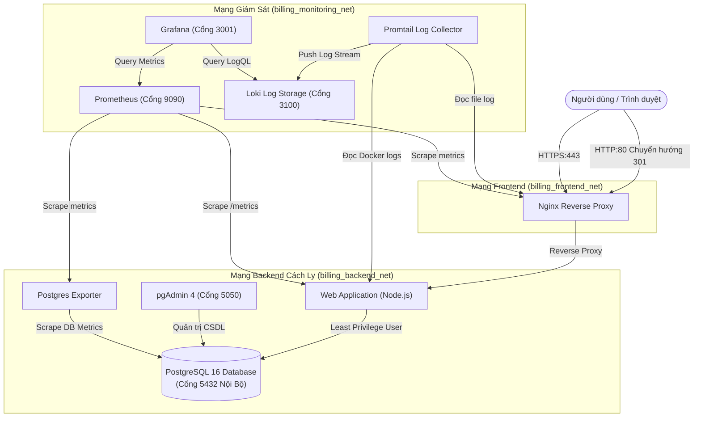

# HỆ THỐNG QUẢN LÝ HÓA ĐƠN & THANH TOÁN (BILLING MANAGEMENT SYSTEM)

> **Môn học**: Triển khai và Quản trị Hệ thống Phần mềm
> 
> **Đề tài 18**: Hệ thống Quản lý Hóa đơn / Billing
> 
> **Sinh viên thực hiện**: Đằng Hữu Chinh
> 
> **Mã số sinh viên**: DTC235210007
> 
> **Lớp**: CNTT K23H
> 
> **Giảng viên hướng dẫn**: ThS.Lê Khánh Dương

---

## 📌 1. TỔNG QUAN HỆ THỐNG

Hệ thống Quản lý Hóa đơn (Billing Management System) là giải pháp quản trị toàn diện cho doanh nghiệp nhằm tự động hóa quy trình phát hành hóa đơn, quản lý khách hàng và theo dõi thanh toán. Hệ thống được đóng gói và triển khai hoàn toàn bằng **Docker Compose**, tích hợp đầy đủ các tiêu chuẩn vận hành DevOps/SysAdmin hiện đại:

- **Ứng dụng Web (Node.js/Express)**: Dashboard phân tích, quản lý danh bạ khách hàng, tạo và xuất hóa đơn điện tử VAT, theo dõi công nợ và ghi nhận các đợt thanh toán.
- **Cơ sở dữ liệu (PostgreSQL 16 & pgAdmin 4)**: CSDL quan hệ tối ưu hóa hiệu năng, có cơ chế kết nối tự động và phân quyền Least Privilege.
- **Nginx Reverse Proxy**: Chuyển hướng tự động HTTP sang HTTPS (SSL tự ký 2048-bit), tích hợp bộ 7 Security Headers chống tấn công web và Rate Limiting chống DoS.
- **Hệ thống Giám sát (Prometheus & Grafana)**: Tự động thu thập metrics từ ứng dụng (`/metrics`), cơ sở dữ liệu (`postgres-exporter`), tài nguyên hệ thống và trực quan hóa qua 2 Dashboard chuyên nghiệp.
- **Hệ thống Ghi log tập trung (Loki & Promtail)**: Tự động gom toàn bộ log định dạng JSON có cấu trúc từ Web App và Nginx, cho phép truy vấn trực tiếp bằng ngôn ngữ **LogQL**.
- **Hardening Bảo mật Hệ thống**: Non-root container (UID 10001), phân vùng mạng cách ly 3 tầng (Network Isolation), mật khẩu phức tạp, tắt lộ phiên bản phần mềm.

---

## 🏗️ 2. KIẾN TRÚC HỆ THỐNG & PHÂN VÙNG MẠNG



---

## 🌐 3. BẢNG CỔNG DỊCH VỤ & TÀI KHOẢN MẶC ĐỊNH

| Dịch vụ | Địa chỉ truy cập | Giao thức | Tài khoản / Mật khẩu | Chức năng |
| :--- | :--- | :--- | :--- | :--- |
| **Website Quản lý Hóa đơn** | `https://localhost` | HTTPS | Truy cập trực tiếp | Tạo/quản lý hóa đơn, khách hàng, thanh toán |
| **Chuyển hướng Web** | `http://localhost` | HTTP | Tự động chuyển sang HTTPS | Redirect 301 |
| **pgAdmin 4** | `http://localhost:5050` | HTTP | Email: `admin@billing.local`<br>Pass: `PgAdmin_Secure#2026` | Quản trị CSDL PostgreSQL trực quan |
| **Grafana Dashboard** | `http://localhost:3001` | HTTP | User: `admin`<br>Pass: `Grafana_Admin#2026` | Giám sát Metrics & Truy vấn LogQL |
| **Prometheus Server** | `http://localhost:9090` | HTTP | Không cần đăng nhập | Kiểm tra trạng thái Scrape Targets & Metrics |
| **Loki Log Server** | `http://localhost:3100` | HTTP | API Endpoint | Lưu trữ và index log tập trung |
| **Web App Healthcheck** | `https://localhost/health` | HTTPS | JSON status | Kiểm tra độ sẵn sàng của ứng dụng |
| **Prometheus Metrics** | `https://localhost/metrics` | HTTPS | Raw metrics format | Endpoint trích xuất chỉ số giám sát |

---

## 🚀 4. HƯỚNG DẪN KHỞI CHẠY HỆ THỐNG

### Điều kiện tiên quyết:
- Đã cài đặt **Docker** và **Docker Compose** (hoặc Docker Desktop trên Windows/macOS).
- Đã cài đặt **Git**.

### Các bước thực hiện:

#### Bước 1: Khởi tạo biến môi trường
File `.env` đã được cấu hình sẵn với các mật khẩu mạnh đạt chuẩn. Bạn có thể kiểm tra hoặc điều chỉnh nếu cần:
```bash
# Xem file cấu hình môi trường
cat .env
```

#### Bước 2: Khởi động toàn bộ cụm dịch vụ bằng Docker Compose
Chạy câu lệnh duy nhất sau tại thư mục gốc:
```bash
docker compose up -d --build
```

#### Bước 3: Kiểm tra trạng thái các container
```bash
docker compose ps
```
*Tất cả 9 dịch vụ (`billing_app`, `billing_db`, `billing_pgadmin`, `billing_nginx`, `billing_prometheus`, `billing_grafana`, `billing_postgres_exporter`, `billing_loki`, `billing_promtail`) đều ở trạng thái `Up` (hoặc `healthy`).*

#### Bước 4: Tự động khởi tạo 3 commit Git theo đúng tiêu chí đề bài
Chỉ cần chạy file script tự động:
- **Trên Windows (cmd/PowerShell)**:
  ```cmd
  .\setup-git.bat
  ```
- **Trên Linux/macOS**:
  ```bash
  chmod +x ./setup-git.sh
  ./setup-git.sh
  ```

---

## 🔍 5. HƯỚNG DẪN KIỂM THỬ & MINH CHỨNG THEO TIÊU CHÍ ĐÁNH GIÁ

### ✅ Tiêu chí 1: Quản lý mã nguồn trên GitHub (1.5 điểm)
- Kiểm tra lịch sử 03 commits có nội dung rõ ràng, đúng lộ trình phát triển:
  ```bash
  git log --oneline
  ```
  *Kết quả hiển thị đủ 3 commit:*
  1. `feat: Khởi tạo ứng dụng Web Quản lý Hóa đơn, PostgreSQL, pgAdmin và Nginx Reverse Proxy với HTTPS & Security Headers`
  2. `feat: Tích hợp hệ thống giám sát Prometheus và Grafana Dashboards cho Web App và PostgreSQL Database`
  3. `feat: Triển khai hệ thống ghi log tập trung Loki + Promtail, truy vấn LogQL và cấu hình Hardening bảo mật hệ thống`

---

### ✅ Tiêu chí 2: Triển khai Ứng dụng & Database (1.5 điểm)
1. **Truy cập Website**: Mở trình duyệt vào `https://localhost` (chọn Tiếp tục / Accept Risk do chứng chỉ SSL tự ký).
   - Trang **Bảng điều khiển**: Hiển thị tổng doanh thu, biểu đồ tài chính Chart.js, hóa đơn và giao dịch mới nhất.
   - Trang **Quản lý Khách hàng**: Thêm, sửa, xóa, tìm kiếm khách hàng.
   - Trang **Quản lý Hóa đơn**: Lọc hóa đơn theo trạng thái (Đã TT, Chờ TT, Quá hạn), bấm Tạo hóa đơn mới với chức năng tự động tính tổng tiền và thuế VAT thời gian thực.
   - Xem chi tiết hóa đơn: Mẫu hóa đơn điện tử chuyên nghiệp, bấm nút **In / Xuất PDF Hóa Đơn**.
   - Trang **Thanh toán**: Ghi nhận thanh toán theo từng đợt, tự động cập nhật trạng thái hóa đơn sang "Đã thanh toán" khi trả đủ tiền.
2. **Quản trị Database qua pgAdmin**:
   - Truy cập `http://localhost:5050`
   - Đăng nhập với email `admin@billing.local` / pass `PgAdmin_Secure#2026`.
   - Vào mục **Servers**: Server `PostgreSQL Billing Database` đã được tự động kết nối sẵn thông qua file cấu hình `servers.json`.
   - Xem bảng dữ liệu: `billing_db -> Schemas -> public -> Tables` (gồm 4 bảng: `customers`, `invoices`, `invoice_items`, `payments`).

---

### ✅ Tiêu chí 3: Cấu hình Nginx Reverse Proxy (1.5 điểm)
1. **Kiểm tra chuyển hướng HTTP sang HTTPS**:
   ```bash
   curl -I http://localhost
   ```
   *Kết quả trả về mã phản hồi `HTTP/1.1 301 Moved Permanently` kèm header `Location: https://localhost/`.*

2. **Kiểm tra HTTPS & Security Headers bảo mật**:
   ```bash
   curl -k -I https://localhost
   ```
   *Xác nhận sự hiện diện của đầy đủ các header bảo mật cao cấp:*
   - `Strict-Transport-Security: max-age=31536000; includeSubDomains`
   - `X-Frame-Options: SAMEORIGIN`
   - `X-Content-Type-Options: nosniff`
   - `X-XSS-Protection: 1; mode=block`
   - `Referrer-Policy: strict-origin-when-cross-origin`
   - `Content-Security-Policy: default-src 'self' ...`
   - `Permissions-Policy: geolocation=(), microphone=(), camera=()`
   - Header ẩn phiên bản Nginx (`Server: nginx` không hiển thị số build).

---

### ✅ Tiêu chí 4: Hệ thống Giám sát Prometheus + Grafana (1.5 điểm)
1. **Kiểm tra Prometheus Targets**:
   - Mở `http://localhost:9090/targets`
   - Tất cả các endpoint (`billing-app`, `postgresql`, `prometheus`) đều có trạng thái **UP** (xanh lá cây).
2. **Kiểm tra Dashboard giám sát trên Grafana**:
   - Truy cập `http://localhost:3001` (Tài khoản: `admin` / `Grafana_Admin#2026`).
   - Vào mục **Dashboards** -> Chọn thư mục **Billing System**:
     - 📊 **Billing Web App - Giám Sát Hiệu Năng & Nghiệp Vụ**: Hiển thị tổng doanh thu, số hóa đơn tạo mới, tần suất request HTTP (RPS), độ trễ phản hồi (p95 latency), Node.js Memory Heap và CPU Usage.
     - 📊 **PostgreSQL Database - Giám Sát Cơ Sở Dữ Liệu**: Giám sát kết nối Active Connections, dung lượng database, tỷ lệ Cache Hit Ratio, tần suất Commit/Rollback transactions.

---

### ✅ Tiêu chí 5: Hệ thống Log Tập trung Loki + Promtail & Truy vấn LogQL (1.5 điểm)
1. Truy cập Grafana: `http://localhost:3001` -> Menu bên trái chọn **Explore** -> Chọn nguồn dữ liệu là **Loki**.
2. Thực hiện ít nhất 3 - 4 câu truy vấn **LogQL** phục vụ chấm điểm:

#### 🔹 Query 1: Lấy toàn bộ log của ứng dụng Web
```logql
{service="billing-web"}
```
*(Hiển thị toàn bộ các request truy cập và luồng xử lý của ứng dụng Web).*

#### 🔹 Query 2: Lọc các log có mức độ Lỗi (ERROR) hoặc cảnh báo (WARN)
```logql
{service="billing-web"} | json | level =~ "error|warn"
```
*(Để kiểm thử sinh log lỗi thực tế: bấm vào nút màu đỏ **"Tạo Log Lỗi (Test Loki)"** ở góc trên cùng của Website hoặc mở URL `https://localhost/api/trigger-error`, sau đó chạy lại query trên để thấy bản ghi lỗi hiển thị ngay lập tức).*

#### 🔹 Query 3: Thống kê tần suất request theo mã trạng thái HTTP (Rate Query)
```logql
sum by (status) (rate({job="nginx"} | json [1m]))
```
*(Trực quan hóa biểu đồ phân bố lưu lượng theo HTTP 200, 301, 404, 500).*

#### 🔹 Query 4: Truy vấn log Nginx truy cập vào module hóa đơn
```logql
{job="nginx"} |= "invoices" | json | status == 200
```

---

### ✅ Tiêu chí 6: Áp dụng các biện pháp Hardening Bảo mật (1.5 điểm)
Hệ thống đã triển khai vượt mức yêu cầu với 6 biện pháp bảo mật thực tế:

1. **Non-Root Container**:
   - Dockerfile của ứng dụng Web tạo `appuser:appgroup` với UID/GID `10001` và chuyển ngữ cảnh thực thi `USER appuser`.
   - Kiểm tra bằng lệnh: `docker compose exec app id` (kết quả trả về `uid=10001(appuser) gid=10001(appgroup)`).
2. **Network Isolation (Phân vùng mạng 3 tầng)**:
   - Cơ sở dữ liệu PostgreSQL chỉ nằm trong mạng nội bộ `billing_backend_net`, tuyệt đối không mở cổng `5432` ra máy chủ host. Người ngoài không thể tấn công trực tiếp vào port Database.
3. **Mật khẩu mạnh & Secret Isolation**:
   - Tất cả mật khẩu quản trị CSDL, pgAdmin, Grafana đều có độ phức tạp cao (>12 ký tự, kết hợp chữ hoa, chữ thường, số, ký tự đặc biệt). File `.env` chứa bí mật được đưa vào `.gitignore` để không bao giờ bị lộ lên GitHub.
4. **Hạn chế đặc quyền Database (Principle of Least Privilege)**:
   - Ứng dụng kết nối thông qua tài khoản nghiệp vụ `billing_user` chỉ có quyền thao tác trên CSDL `billing_db`, không sử dụng quyền siêu người dùng `postgres`.
5. **Nginx Security Hardening**:
   - Vô hiệu hóa tiết lộ phiên bản `server_tokens off;`.
   - Giới hạn tần suất truy cập `limit_req_zone` 15 req/giây để ngăn chặn tấn công DoS và Brute Force.
   - Áp dụng đầy đủ 7 Security Headers (HSTS, CSP, X-Frame-Options, X-Content-Type-Options...).
6. **Container Security & Resource Quota**:
   - Cấu hình cờ bảo mật `security_opt: [ "no-new-privileges:true" ]` ngăn chặn tiến trình con leo thang đặc quyền.
   - Giới hạn hạn mức CPU và RAM tối đa trong `docker-compose.yml` để chống cạn kiệt tài nguyên host.

---

## 🛑 6. LỆNH DỌN DẸP & DỪNG HỆ THỐNG

Khi hoàn tất buổi bảo vệ hoặc kiểm thử:
```bash
# Dừng các container
docker compose down

# Dừng và xóa toàn bộ dữ liệu volume (nếu muốn cài đặt lại từ đầu)
docker compose down -v
```
